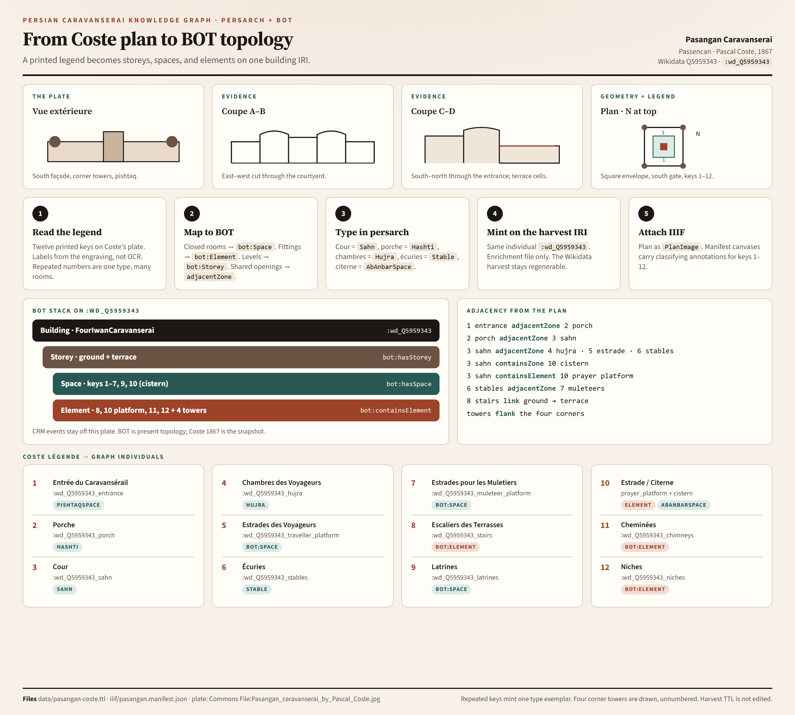

# From Coste plan to BOT topology

Pasangan (Wikidata [Q5959343](https://www.wikidata.org/wiki/Q5959343), Coste’s *Passencan*) is the first harvest record whose **present topology** is read from a measured plate.

Infographic: [`docs/infographics/coste-plan-to-bot.png`](infographics/coste-plan-to-bot.png) (source: [`coste-plan-to-bot.html`](infographics/coste-plan-to-bot.html)).



## Why a legend-bearing plan

BOT answers *what sits next to what*. Coste’s 1867 plate in *Monuments modernes de la Perse* is a 2D projection of that graph: vue extérieure, coupe A–B, coupe C–D, and a numbered plan. The **printed légende** supplies identity (this hatch is a *cour*, this numeral is an *écurie*). Scan quality is poor; labels follow the engraving, not OCR.

## Pipeline

1. **Read the legend** — twelve keys. A repeated number is a type key.
2. **Map to BOT at instance grain** — each closed room with a distinct neighbour set is its own `bot:Space`; fittings → `bot:Element`; levels → `bot:Storey`; shared openings → `bot:adjacentZone`. A series `bot:Zone` `containsZone` the instances of one Coste key.
3. **Type in persarch** — Cour = `Sahn`, porche = `Hashti`, chambres = `Hujra`, écuries = `Stable`, citerne = `AbAnbarSpace`.
4. **Mint on the harvest IRI** — same individual `:wd_Q5959343`. Enrichment lives in [`data/pasangan-coste.ttl`](../data/pasangan-coste.ttl). The Wikidata harvest file stays regenerable.
5. **Attach IIIF** — the plate is a `persarch:PlanImage`. [`iiif/pasangan.manifest.json`](../iiif/pasangan.manifest.json) carries classifying annotations for keys 1–12 and for each Coste 7 bay.
6. **Measure from the printed scale** — CIDOC CRM `E16_Measurement` / `E54_Dimension` on the same harvest IRI. Method is `persarch:method_scale_bar`. Production and patronage events stay out of scope for this plate.

BOT is present topology; Coste 1867 is the snapshot. Scale-bar lengths are estimates in printed metres, with `persarch:uncertaintyMetre` on linear dimensions.

## Legend → individuals

| Key | Coste | Individual | Class |
| --- | --- | --- | --- |
| 1 | Entrée du Caravansérail | `:wd_Q5959343_entrance` | `persarch:PishtaqSpace` |
| 2 | Porche | `:wd_Q5959343_porch` | `persarch:Hashti` |
| 3 | Cour | `:wd_Q5959343_sahn` | `persarch:Sahn` |
| 4 | Chambres des Voyageurs | `:wd_Q5959343_hujra` | `persarch:Hujra` |
| 5 | Estrades des Voyageurs | `:wd_Q5959343_traveller_platform` | `bot:Space` |
| 6 | Écuries | `:wd_Q5959343_stables` (series Zone) + `_n` `_e` `_s` `_w` | `bot:Zone` / `persarch:Stable` |
| 7 | Estrades pour les Muletiers | `:wd_Q5959343_muleteer_platform` (series Zone) + 16 bays `_n_1`…`_w_4` | `bot:Zone` / `bot:Space` |
| 8 | Escaliers des Terrasses | `:wd_Q5959343_stairs` | `bot:Element` |
| 9 | Latrines | `:wd_Q5959343_latrines` | `bot:Space` |
| 10 | Estrade pour la prière, audessous Citerne | `:wd_Q5959343_prayer_platform` + `:wd_Q5959343_cistern` | `bot:Element` + `persarch:AbAnbarSpace` |
| 11 | Cheminées | `:wd_Q5959343_chimneys` | `bot:Element` |
| 12 | Niches | `:wd_Q5959343_niches` | `bot:Element` |

Four circular **corner towers** are drawn and unnumbered (`persarch:CornerTower`).

## Scale-bar dimensions (CIDOC CRM)

Calibration on the Wikimedia JPEG (1707×2514): plan *échelle* 0–40 m = 750 px (18.75 px/m); coupes 0–20 m share that graphic length (37.5 px/m). Envelope ±1 m; interiors ±0.5 m. Horizontal (E–W) is trusted more than N–S. These figures are the Coste envelope, not UNESCO `propertyAreaHectare` and not later 50 × 50 m / 2500 m² site figures.

| Individual | Type | Value | Unit | Taken from |
| --- | --- | --- | --- | --- |
| `:dim_wd_Q5959343_length_ew` | length | 40 | m | plan, towers included (752 px) |
| `:dim_wd_Q5959343_width_ns` | width | 38 | m | plan, towers included (715 px) |
| `:dim_wd_Q5959343_height` | height | 6 | m | coupe C–D, ground to merlons |
| `:dim_wd_Q5959343_area` | area | 1520 | m² | 40 × 38 m |
| `:dim_wd_Q5959343_sahn_width` | width | 22.5 | m | court E–W max (422 px) |
| `:dim_wd_Q5959343_sahn_area` | area | 510 | m² | rectangle equivalent |
| `:dim_wd_Q5959343_porch_diameter` | diameter | 5.5 | m | Coste 2 (100 px) |
| `:dim_wd_Q5959343_cistern_side` | length | 5.5 | m | Coste 10 square (100 px) |
| `:dim_wd_Q5959343_cistern_area` | area | 30 | m² | 5.5 × 5.5 m |
| `:dim_wd_Q5959343_tower_diameter` | diameter | 5 | m | SW tower exemplar (90 px) |

One `crm:E16_Measurement` (`:Measurement_Coste_Passencan_scale`) `P39_measured` `:wd_Q5959343` and `P40_observed_dimension` all ten `E54` individuals. `P43_has_dimension` hangs the values on the building, sahn, porch, cistern, and SW tower.

## Instance grain (Coste 6 and 7)

BOT relations hang on **individuals**. Coste **7** is sixteen rooms on the outer ring (four per side, including a pair at each corner tower). Coste **6** is four stable ranges. The legacy IRIs stay as series `bot:Zone` nodes so SPARQL can still ask for “all muleteer platforms”.

Bay index, re-findable on the plate: north and south **west→east**; east and west **north→south**.

| Instance | Neighbours on the plan |
| --- | --- |
| `_n_1` / `_w_1` | each other; `tower_nw`; north/west stables; latrines |
| `_n_4` / `_e_1` | each other; `tower_ne`; north/east stables; latrines |
| `_e_4` / `_s_4` | each other; `tower_se`; east/south stables; latrines |
| `_s_1` / `_w_4` | each other; `tower_sw`; south/west stables; latrines |
| `_n_2`, `_n_3`, `_e_2`, `_e_3`, `_w_2`, `_w_3` | that range’s stables; traveller platforms (5); hujra (4) |
| `_s_2`, `_s_3` | south stables; hujra flanking the porch; latrines |

Keys 4, 5, 8, 9, 11, 12 remain series individuals until the same census.

## Adjacency (from the plan)

- 1 entrance `adjacentZone` 2 porch `adjacentZone` 3 sahn
- 3 sahn `adjacentZone` 4 hujra, 5 estrade (inner ring)
- 3 sahn `containsZone` 10 cistern; `containsElement` 10 prayer platform
- each Coste 7 room `adjacentZone` its side’s Coste 6 range
- 8 stairs link ground storey to terrace (coupe C–D)

## Regenerating the figure

The PNG is a Chrome headless screenshot of the HTML so every Coste number stays exact (image models garble labels). From the repo root:

```powershell
$html = (Resolve-Path "docs\infographics\coste-plan-to-bot.html").Path
$png  = (Resolve-Path "docs\infographics").Path + "\coste-plan-to-bot.png"
$uri  = ([Uri]$html).AbsoluteUri
& "C:\Program Files (x86)\Google\Chrome\Application\chrome.exe" --headless=new --disable-gpu --hide-scrollbars --force-device-scale-factor=2 --window-size=1400,1260 --virtual-time-budget=10000 --screenshot=$png $uri
```

A Gemini NotebookLM slide deck can be generated later from this markdown. The HTML/PNG remains the labelled figure of record.
